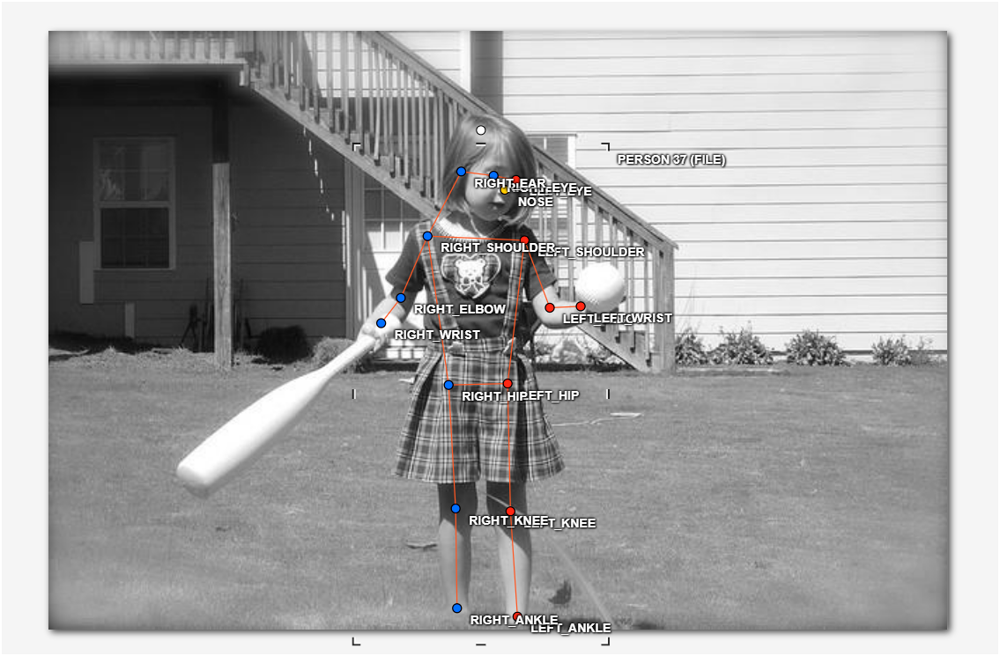
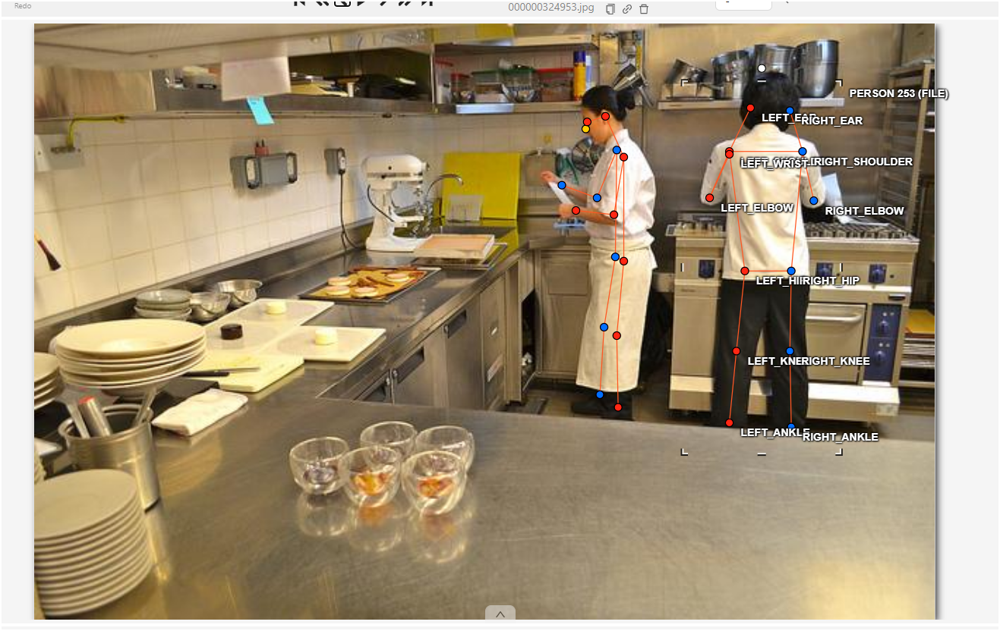
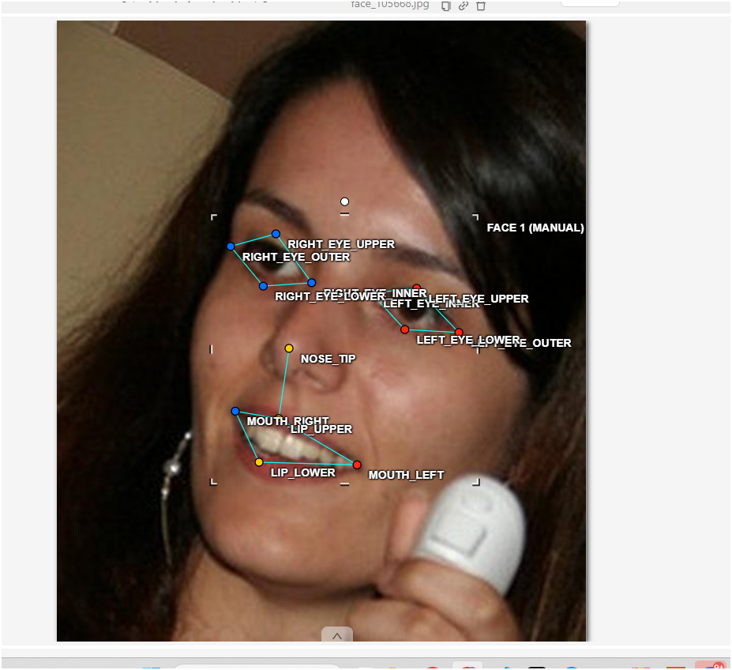
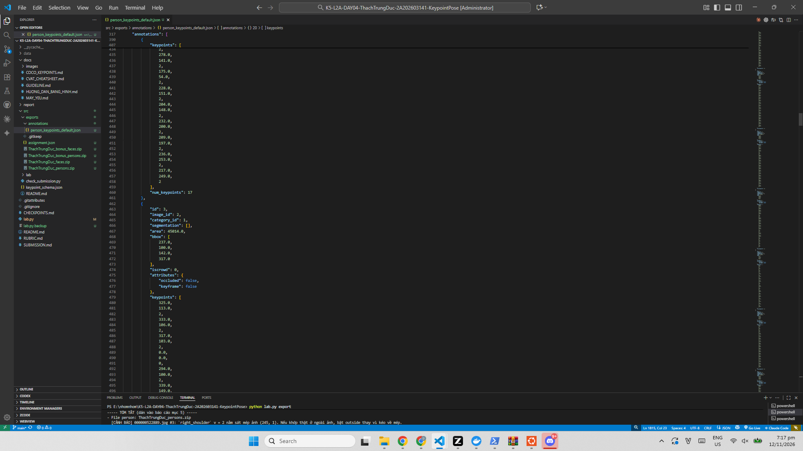

# Báo cáo cá nhân — ThachTrungDuc-2A202603141

Dữ liệu: 12 ảnh người COCO val2017 (Lin et al., 2014) và 8 ảnh chân dung cắt từ COCO, chỉ dùng trong lớp.

## 0. Thông tin học viên

- Họ tên: Thạch Trung Đức
- MSSV: 2A202603141
- Email: *(điền email của bạn)*
- Link repository: https://github.com/ThachDuc123/K5-L2A-DAY04-ThachTrungDuc-2A202603141-KeypointPose
- Phiên bản CVAT (Help → About): 2.74.1
- Máy: hệ điều hành Windows 11 · RAM: Docker dùng tối đa 7,6 GB (`lab.py check` báo OK) · chạy CVAT chế độ đầy đủ
- Bộ ảnh (`src/exports/assignment.json` do `lab.py setup` tạo): có
- Giờ bắt đầu: 16:50
- Giờ kết thúc: 20:30

## 1. Kiểm tra label (CP0)

| Label | Kiểu | Số điểm | Tên điểm đúng bảng của lab? | Đúng thứ tự? | Số cạnh |
|---|---|---:|---|---|---:|
| `person` | Skeleton | 17 | Có (`nose`, `left_eye`, `right_eye`, `left_ear`, `right_ear`, `left_shoulder`, `right_shoulder`, `left_elbow`, `right_elbow`, `left_wrist`, `right_wrist`, `left_hip`, `right_hip`, `left_knee`, `right_knee`, `left_ankle`, `right_ankle`) | Có | 19 |
| `face` | Skeleton | 13 | Có (`left_eye_outer`, `left_eye_inner`, `left_eye_upper`, `left_eye_lower`, `right_eye_outer`, `right_eye_inner`, `right_eye_upper`, `right_eye_lower`, `nose_tip`, `mouth_left`, `mouth_right`, `lip_upper`, `lip_lower`) | Có | 13 |

Mẫu `person` dựng theo người quay mặt về camera (các điểm `left_*` nằm bên phải khung mẫu)? **Có**

Cách đổi cờ `occluded` / `outside` cho **một điểm** trên phiên bản CVAT này (một câu):

Rê chuột vào đúng điểm đó rồi bấm `Q` để bật/tắt `occluded` (`v = 1`) hoặc `O` để bật/tắt `outside` (`v = 0`); cũng có thể chuột phải vào điểm chọn một trong 4 nút outside · khóa · occluded · hidden. Chỉ điểm đang rê chuột bị đổi, các điểm khác và skeleton giữ nguyên.

## 2. Số lượng đã gán và thời gian (CP1, CP2)

| Nhóm ảnh | Số ảnh | Số skeleton đã gán | Số người dưới 60 px (không gán) | Số poster / gương / màn hình bỏ qua | Thời gian (phút) |
|---|---:|---:|---:|---:|---:|
| `easy` | 5 | 5 | 0 | 0 | 25 |
| `occluded` | 3 | 6 | 0 | 0 | 22 |
| `back` | 2 | 4 | 0 | 0 | 16 |
| `small` | 1 | 2 | 0 | 0 | 10 |
| `crowd` | 1 | 3 | 1 | 0 | 15 |
| `faces` | 8 | 8 | — | 0 | 28 |

- Số ảnh người đã xong ở mốc phút 105: 8 / 10
- Thời gian thực tế (phút): CP1 100 · CP2 28 · CP3 20
- Ảnh tốn thời gian nhất là ảnh nào, vì sao? Ảnh crowd `000000522889` — 3 người chồng lên nhau, người thứ 3 bị người trước che gần hết thân nên phải lần lượt ước lượng từng điểm và quyết định cờ cho 8 điểm không thấy (mắt, tai, vai phải, tay phải).

## 3. Bảng ca khó (CP1, CP2)

Mỗi điểm bạn phân vân một dòng, nhất là phân vân giữa `v = 1` và `v = 0`, hoặc không chắc hướng người.

| Ảnh | Người / mặt | Điểm | Cờ đã chọn | Phân vân giữa | Lý do chọn |
|---|---|---|---:|---|---|
| `000000522889` (crowd) | Người #3 | `left_knee` | `v = 1` | `v = 1` / `v = 0` | Đầu gối bị người đứng trước che nhưng theo hướng cẳng chân vẫn ước lượng chắc được vị trí → occluded |
| `000000522889` (crowd) | Người #3 | mắt, tai, vai–tay phải (8 điểm) | `v = 0` | `v = 1` / `v = 0` | Bị che hoàn toàn bởi người trước, không còn mốc nào để ước lượng → đoán bừa có `v > 0` hại hơn `v = 0` |
| `000000167027` (small) | Người #2 | nose, 2 mắt, vai–tay trái, mắt cá trái (7 điểm) | `v = 0` | `v = 1` / `v = 0` | Người rất nhỏ và mờ, không phóng to được đủ để đặt điểm chắc |
| `000000091637` (occluded) | Người #1 | nose, 2 mắt, `left_wrist` | `v = 0` | `v = 1` / `v = 0` | Đầu quay ra khỏi khung ảnh, không thấy mặt; tay phải bị chướng ngại che |
| `000000177338` (occluded) | Người #1 | `left_eye`, `left_ear` | `v = 0` | `v = 1` / `v = 0` | Nửa mặt khuất trong bóng tối, chỉ thấy đường viền mờ |
| `face_301643` (kính râm) | Mặt | 8 điểm mắt | `v = 1` *(đã sửa từ `v = 0`)* | `v = 1` / `v = 0` | Mắt sau tròng kính tối: theo luật lab là occluded, đặt theo gọng kính |

## 4. Bảng tự review (CP3)

Đi từ ảnh cuối về ảnh đầu. 5 ảnh người (ít nhất 2 ảnh `back` hoặc `crowd`) và 3 ảnh mặt. Ít nhất 8 dòng, kể cả dòng `ok`. Ghi lỗi trước, sửa sau.

Mã lỗi dùng đúng một trong: `lr_swap`, `vis_flag`, `position`, `missing`, `extra`, `ok`.

| Ảnh | Người / mặt | Điểm | Mã lỗi | Ghi chú | Đã sửa? |
|---|---|---|---|---|---|
| `000000522889` | Người #3 | cặp knee–ankle | `ok` | Script cảnh báo nghi `lr_swap`: kiểm tọa độ — vai/hông trái ở bên phải ảnh nhưng đầu gối/cổ chân trái ở bên trái ảnh → chân bắt chéo thật, không phải đổi trái/phải. Giữ nguyên | Có (giữ nguyên) |
| `face_301643` | Mặt | 8 điểm mắt | `vis_flag` | Mắt sau kính râm đang là `outside` (`v = 0`) trong khi luật lab yêu cầu `occluded` (`v = 1`); tọa độ cũng chưa nằm trên gọng kính | Có (`fix_kinh_ram.py` sửa trên CVAT rồi `lab.py export` lại) |
| `000000351176` | Người #2 | toàn bộ 17 điểm | `ok` | Người quay lưng: đã đổi `left_*` sang bên trái ảnh trước khi tinh chỉnh; đường nối không bắt chéo | — |
| `000000210604` | Người #1 | nose, 2 mắt, `right_ear` | `ok` | Quay lưng, mặt hoàn toàn không thấy → `outside` đúng luật, không kéo về mép | — |
| `000000225138` | Người #1 | cặp knee–ankle | `ok` | Script không cảnh báo; tự kiểm: hai chân đứng khít nhau, `left/right` lệch 5–6 px là nhiễu, không phải đổi cặp | — |
| `000000177338` | Người #2 | `left_ankle` | `ok` | `v = 0` xuất ra tọa độ `0, 0` làm phép kiểm đối xứng lệch dấu — không phải lỗi nhãn | — |
| `face_155465` | Mặt | 6 điểm mắt | `ok` | Khóe trong (`*_eye_inner`) gần sống mũi hơn khóe ngoài; `upper` trên `lower`; mắt trái bên phải ảnh | — |
| `face_41666` | Mặt (tóc che) | 13 điểm | `ok` | Tóc chỉ che trán/gáy, mắt–mũi–miệng vẫn thấy rõ, giữ `v = 2` | — |

Tổng hợp số lỗi theo mã:

| `lr_swap` | `vis_flag` | `position` | `missing` | `extra` | `ok` |
|---:|---:|---:|---:|---:|---:|
| 0 | 1 | 0 | 0 | 0 | 7 |

Điểm còn phân vân giữa `v = 1` và `v = 0` (ghi cả hai lựa chọn và lý do chọn):

- `000000522889` người #3 `left_knee`: chọn `v = 1` vì chân vẫn có hướng rõ (theo hông và cẳng chân); nếu chọn `v = 0` thì model mất một mẫu học "đầu gối bị che nhưng vẫn biết chỗ".
- `face_301643` 8 điểm mắt: ban đầu chọn `v = 0`, review thấy sai luật (kính râm phải là `v = 1`) → đã sửa. Lý do ban đầu chọn sai: ngại rằng sau tròng kính tối "không thấy gì".

## 5. Kiểm file xuất và kết quả tự kiểm (CP4)

Tự kiểm tay trong file JSON:

| File | Người / mặt kiểm (ảnh, thứ tự) | Số phần tử `keypoints` | Điểm `outside` ra `v = 0`, `occluded` ra `v = 1`? | `num_keypoints` khớp? |
|---|---|---:|---|---|
| `ThachTrungDuc_persons.zip` | `000000194027` người #2 | 51 | Có (17/17 điểm `v = 2`) | Có (17 = số điểm `v > 0`) |
| `ThachTrungDuc_persons.zip` | `000000522889` người #3 | 51 | Có (`left_knee` occluded → `v = 1`; `right_ear` outside → `v = 0`) | Có (16) |
| `ThachTrungDuc_faces.zip` | `face_575921` | 39 | Có (13/13 điểm `v = 2`) | Có (13) |

Sau khi xuất, CVAT ghi `occluded` thành `v = 1` và `outside` thành `v = 0`. Tọa độ của điểm `outside` trong file là `0, 0` hay tọa độ cũ? **Phần lớn là tọa độ cũ (11 điểm); một số điểm xuất ra `0, 0` (ví dụ `right_ear` của người #3 ảnh crowd)** — chuẩn COCO ghi `0, 0`, nhưng điểm `v = 0` không được dùng khi huấn luyện và khi chấm nên không ảnh hưởng.

Hai job đã chuyển sang completed trên CVAT? Có *(kiểm lại sau lần `export` cuối)*

Dán phần **TÓM TẮT** in ra từ `src/check_submission.py`:

```text
- File person: ThachTrungDuc_persons.zip
  Số ảnh: 12 · số skeleton `person`: 20 · mỗi annotation 51 số
  Skeleton theo ảnh: 000000091637=2, 000000156069=1, 000000167027=2, 000000177338=2, 000000194027=1, 000000210604=2, 000000225138=1, 000000241837=1, 000000324953=2, 000000351176=2, 000000493741=1, 000000522889=3
  Cờ v: v=2 292 (86%) · v=1 1 (0%) · v=0 47 (14%)
  num_keypoints trung bình: 14.7
- File face: ThachTrungDuc_faces.zip
  Số ảnh: 8 · số skeleton `face`: 8 · mỗi annotation 39 số
  Skeleton theo ảnh: face_105668=1, face_143959=1, face_155465=1, face_301643=1, face_380639=1, face_41666=1, face_442231=1, face_575921=1
  Cờ v: v=2 96 (92%) · v=1 0 (0%) · v=0 8 (8%)
  num_keypoints trung bình: 12.0
- Ghi chú: 11 điểm v = 0 vẫn mang tọa độ cũ (CVAT 2.x xuất như vậy; chuẩn COCO ghi 0, 0). Không phải lỗi: điểm v = 0 bị bỏ qua khi huấn luyện và khi chấm.
- Số [LỖI]: 0 · số [CẢNH BÁO]: 1
Kết quả: ĐẠT (đọc lại từng cảnh báo ở trên)
```

*(Lưu ý: chạy `fix_kinh_ram.py` + `python lab.py export` lần cuối thì dán lại TÓM TẮT mới — file face sẽ hiện 8 điểm `v = 1`.)*

Các `[CẢNH BÁO]` còn giữ nguyên và lý do:

- `000000522889` người #3 "cặp knee, ankle nằm ngược phía so với các cặp còn lại": giữ nguyên — đây là chân bắt chéo thật. Bằng chứng: vai và hông trái nằm bên phải ảnh (người quay mặt về camera) nhưng đầu gối/cổ chân trái vắt sang bên trái ảnh, đúng tư thế ngồi vắt chân; nếu đổi trái/phải cho cặp này thì hai chân sẽ nối thành hình bất khả thi.

## 6. Ảnh chụp màn hình

1. Label `person` trong label constructor (đủ 17 điểm có tên):

   

2. Một người quay lưng đã gán, cờ đã đặt:

   

3. Một khuôn mặt đã gán 13 điểm, phóng to vùng mắt:

   

4. Một đoạn JSON xuất của một người:

   

Nguồn ảnh: COCO val2017 / Wikimedia Commons.

## 7. Tự đánh giá

1. Lỗi bạn mắc nhiều nhất hôm nay, và cách bạn sẽ tránh ở dự án thật:

   Nhầm cờ visibility: để 8 điểm mắt ảnh kính râm ở `v = 0` (outside) trong khi luật yêu cầu `v = 1` (occluded). Cách tránh: với mỗi điểm không thấy rõ, trả lời đủ 4 câu của guideline trước khi bấm cờ — "có ước lượng chắc được vị trí không?" thì mới `v = 1`; chỉ khi ngoài ảnh hoặc hoàn toàn không đoán được mới `v = 0`. Ở dự án thật sẽ rà lại đúng một lớp cờ (`occluded` / `outside`) cho cả ảnh trước khi bấm xong.

2. Một quy tắc bạn đề xuất thêm vào guideline (kèm ảnh ví dụ nếu có):

   Thêm quy tắc cho người nhỏ: nếu người cao dưới ~150 px thì chỉ gán các điểm torso và chân khi thật sự thấy; mắt/mũi/tai mặc định `outside` thay vì kéo theo "ước lượng" (vì ở cỡ đó, lệch 2 px là sai cả bàn mặt). Đối chiếu: ảnh `small` thứ hai của bộ này có 7 điểm như vậy và bài làm đã chọn `outside`.

3. Nhãn của bạn đi vào model ở đâu? Chọn một lỗi bạn đã sửa và nói nó sẽ làm model học sai thế nào (heatmap, trọng số trong loss, hay bước lật ảnh):

   Nhãn vào model ở bước tạo heatmap: mỗi điểm `v > 0` thành một đỉnh heatmap, cờ `v` quyết định điểm nào được tính vào loss. Lỗi `vis_flag` đã sửa (8 điểm mắt kính râm `v = 0` → `v = 1`): nếu giữ nguyên, 8 điểm đó bị bỏ hoàn toàn khỏi loss — model không bao giờ học được rằng "mắt sau tròng kính vẫn có vị trí ước lượng được theo gọng kính", mỗi ảnh kính râm đều mất 8 mẫu; đổi thành `v = 1` thì 8 đỉnh heatmap được tạo và được tính trọng số bình thường trong loss.

## 8. Khó khăn và lỗi kỹ thuật

- Lần đầu chạy `python lab.py check`, lệnh đứng lâu ở mục "2. CVAT (cài ở Ngày 2)" — CVAT chưa trả lời kịp (container mới bật); chạy lại sau vài phút thì hết, kết thúc bằng "CVAT sẵn sàng".
- Phân biệt `v = 1` và `v = 0` ở người nhỏ và người bị che: phải tự đặt câu hỏi "có mốc nào để ước lượng không" cho từng điểm.
- Script tự kiểm báo cảnh báo `lr_swap` nghi ngờ cho 2 người (crowd và bonus) — mất thời gian kiểm tọa độ mới chắc chắn là chân bắt chéo thật / điểm `v = 0` tọa độ `0, 0` kéo lệch phép kiểm.
- CVAT 2.x xuất điểm `outside` giữ tọa độ cũ (một số điểm là `0, 0`) — khác chuẩn COCO, phải đọc ghi chú của script mới yên tâm rằng không phải lỗi.

## Bonus (nếu làm)

### B1 — 3 ảnh người khó thêm

| Ảnh | Số skeleton | Số người dưới 60 px | Ca khó nhất |
|---|---:|---:|---|
| `000000073537` | 3 | 0 | Người chồng lên nhau, chia ranh giới tay/chân giữa hai người |
| `000000074156` | 3 | 0 | Người #3: script cảnh báo nghi `lr_swap` cặp knee–ankle — kiểm lại là chân vắt chéo thật, giữ nguyên |
| `000000254060` | 1 | 0 | Chỉ thấy một phần người, nhiều điểm `outside` |

Kết quả `src/check_submission.py` cho `ThachTrungDuc_bonus_persons.zip` và `ThachTrungDuc_bonus_faces.zip`:

```text
- File person: ThachTrungDuc_bonus_persons.zip
  Số ảnh: 3 · số skeleton `person`: 7 · mỗi annotation 51 số
  Skeleton theo ảnh: 000000073537=3, 000000074156=3, 000000254060=1
  Cờ v: v=2 92 (77%) · v=1 0 (0%) · v=0 27 (23%)
  num_keypoints trung bình: 13.1
- File face: ThachTrungDuc_bonus_faces.zip
  Số ảnh: 5 · số skeleton `face`: 5 · mỗi annotation 39 số
  Skeleton theo ảnh: face_300200=1, face_317330=1, face_344941=1, face_379585=1, face_494518=1
  Cờ v: v=2 65 (100%) · v=1 0 (0%) · v=0 0 (0%)
  num_keypoints trung bình: 13.0
- Số [LỖI]: 0 · số [CẢNH BÁO]: 1
Kết quả: ĐẠT (đọc lại từng cảnh báo ở trên)
```

### B2 — 5 ảnh khuôn mặt đen trắng / hồng ngoại

Ảnh không màu khó hơn ở điểm nào? Khó nhất là phân biệt mí trên và mí dưới khi không có màu da/màu môi để định vị: ranh giới mí chỉ còn là thay đổi độ sáng, ảnh nhiễu hạt thì mí trên và khóe mắt gần như trộn vào nhau; khóe miệng cũng khó đặt vì mép môi trên–dưới ít tương phản hơn ảnh màu. Trên ảnh hồng ngoại, tròng kính râm không còn "tối đen" rõ như ảnh màu mà có thể sáng lên hoặc gần trong suốt — nhưng mắt vẫn là mắt bị một lớp vật liệu che, nếu vẫn thấy được vị trí theo gọng kính thì cờ vẫn là `v = 1` (occluded), không phải `v = 2`; chỉ khi hoàn toàn không ước lượng được mới `v = 0`. Bộ 5 mặt này mình giữ `v = 2` cho cả 13 điểm mỗi mặt vì không có ảnh nào che mặt (v=2 100% theo script).

### B3 — Model so với nhãn của tôi (không tính điểm)

Không làm (hết thời gian buffer).

## 9. Tài liệu tham khảo và công cụ AI đã dùng

- Lin, T.-Y. et al. (2014). *Microsoft COCO: Common Objects in Context*. Ảnh train2017/val2017, giấy phép CC BY / CC BY-SA / No known copyright restrictions.
- CVAT 2.74.1 (cài local bằng Docker, Ngày 2); tài liệu CVAT: https://docs.cvat.ai
- Tài liệu lớp: `README.md`, `CHECKPOINTS.md`, `RUBRIC.md`, `docs/GUIDELINE.md`, `docs/CVAT_CHEATSHEET.md`, `docs/COCO_KEYPOINTS.md`.
- Công cụ AI đã dùng: trợ lý ZCode (AI) để (1) chẩn đoán `lab.py check` đứng ở mục 2, (2) phân tích 4 file zip xuất (đếm cờ `v`, kiểm dấu trái/phải từng cặp để hiểu các cảnh báo của script), (3) viết `fix_kinh_ram.py` sửa cờ 8 điểm mắt ảnh kính râm trên CVAT, (4) hỗ trợ viết báo cáo này từ dữ liệu bài làm thật. Tọa độ nhãn hoàn toàn do mình gán trên CVAT, không lấy từ annotation COCO gốc và không chép file xuất của người khác.
